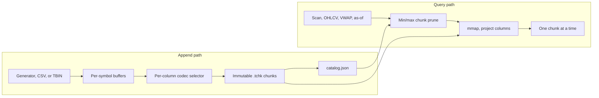
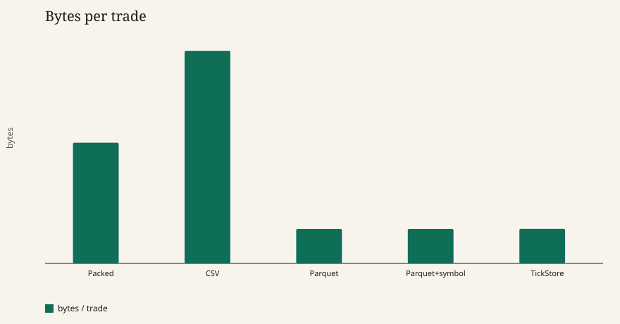
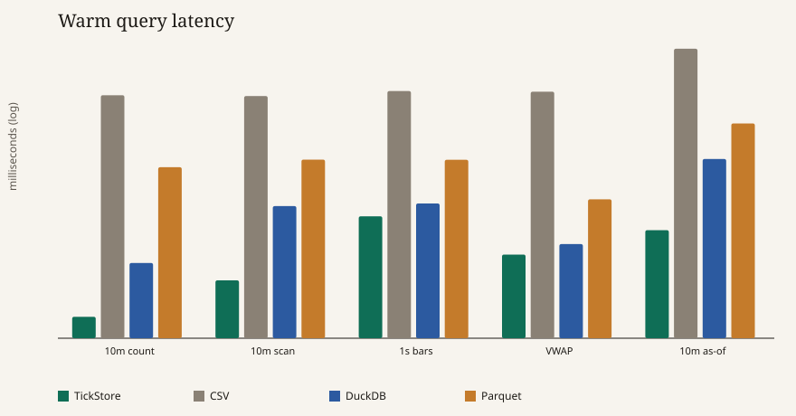
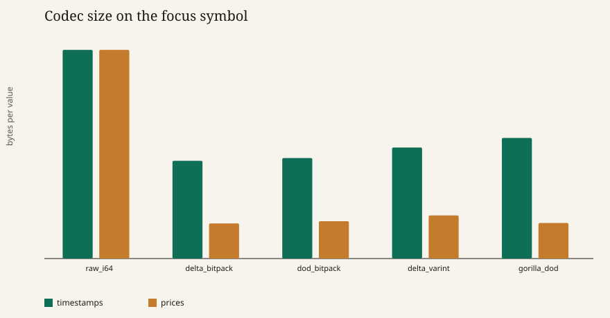

# TickStore

TickStore is a columnar on-disk engine for trade and quote ticks. It is built for the shape of a market-data tape: one symbol at a time, timestamps that only move forward, prices that live on a tick grid, and sizes that repeat. A day of prints should take less space than a CSV and less space than a packed array of integers, and a symbol-and-time query should not have to read the rest of the tape.

The engine is a Rust library and a `tickstore` binary. A Python harness checks the same aggregates in PyArrow Parquet (zstd) and DuckDB, including DuckDB's `ASOF JOIN`.

## Quick start

```bash
cargo test
cargo run --release -- gen --trades 100000 --symbols 4 --out data/synth
cargo run --release -- ingest --input data/synth --store data/demo
cargo run --release -- stats --store data/demo
cargo run --release -- query ohlcv --store data/demo --symbol AAPL --interval 1m --limit 8
cargo run --release -- query vwap --store data/demo --symbol AAPL
cargo run --release -- query asof --store data/demo --symbol AAPL --limit 5
```

The full comparison (this engine, CSV, Parquet zstd, DuckDB) is:

```bash
scripts/bench.sh
```

That writes `bench/run/engine.json`, Parquet files, a DuckDB database, the charts under `docs/`, and refreshes the benchmark section below. Override the size with `TRADES`, `SYMBOLS`, `RATIO`, `REPEATS`, and `WORKDIR`.

Prices in the API are integer ticks. The store's `price_scale` (default `10_000`) turns them back into currency units: `price_ticks / price_scale`. A scale of 10,000 is one hundredth of a cent, which is exact for a one-cent tick. Text import and export use that scale and round-trip the decimal.

## Architecture



A store is a directory.

```text
store/
  catalog.json
  chunks/AAPL/trades/000000.tchk
  chunks/AAPL/quotes/000003.tchk
  chunks/MSFT/trades/000000.tchk
```

Appends are monotonic per symbol and per stream. The writer holds a tail buffer and, every `chunk_rows` (default 16,384), seals an immutable chunk. The catalog is rewritten with `rename` after each seal, so a reader never sees a half-written index. Chunk bytes are not fsynced. A crash can drop the last rename; fixing that is a write-ahead log, not a denser encoding.

The symbol is not a column. The path and the catalog are the dictionary, which is the same idea as a constant run-length: one value, one run, zero bytes in the chunk. Low-cardinality columns that do vary inside the chunk (side, quote size) still use a real dictionary codec when it is smaller.

Queries take a symbol and a half-open time range `[start, end)`. Chunks are ordered, so pruning is a binary search on `max_ts` / `min_ts`, not a scan of the index. Surviving files are memory-mapped. A chunk whose range sits entirely inside the window can answer `count` from the catalog alone. Scans, bars, VWAP, and as-of joins decode only the columns they touch, one chunk at a time.

## File format

Each `.tchk` file is little-endian and self-describing.

| Region | Contents |
| --- | --- |
| 64-byte header | Magic `TCHK`, version 1, trade or quote, row count, min/max timestamp, price scale |
| Column directory | 16 bytes each: column id, codec id, absolute offset, length |
| Payloads | One encoded column after another |
| CRC-32 | IEEE CRC of every preceding byte |

Flipping a payload byte fails the CRC. The codec id is stored per column, so a later reader can decode a chunk without knowing which codec won.

## Encodings

The writer encodes each column with every codec that applies, keeps those within 5% of the smallest, and then picks the fastest expected decode in that band. Raw integers are in the band, so a column that does not compress is stored raw instead of wrapped in a header that makes it larger.

| Codec | Used for | Idea |
| --- | --- | --- |
| Delta mini-block bit-pack | Timestamps, prices | First value, then 128-value blocks of deltas. Each block stores its minimum and a bit width. |
| Delta-of-delta mini-block | Same | Gorilla's second difference, but fixed-width inside the block. |
| Gorilla delta-of-delta | Same | The VLDB 2015 control-bit codes, per value. |
| Zigzag LEB128 delta | Same | One byte for a delta in -64..63, more when the gap is wide. |
| Frame-of-reference bit-pack | Sizes | Same mini-blocks on the raw unsigned values, not on deltas. Sizes are not ordered. |
| Dictionary + bit-packed ids | Sizes, side | First-seen dictionary. Wins when a chunk has a handful of distinct values. |
| RLE | Sizes, side | `(value, run length)` pairs. Wins on long runs, loses when the tape alternates. |
| Unsigned LEB128 | Sizes | Good with outliers, because one large size does not widen every neighbor. |
| Gorilla XOR | Not stored | Implemented and measured. Exact on `f64` bits, including the sign of zero. |

Two choices are deliberate, and the benchmark is what justifies them.

**Prices are scaled integers, not XOR-compressed floats.** A trade price moves by one or two ticks. As an integer that is a delta of ±1 or ±2, which bit-packs into a couple of bits. The same move as an IEEE float changes mantissa bits in a way XOR only partially shares, and a binary float cannot hold 0.01 exactly. XOR remains in the tree so the comparison is measured rather than asserted. It is not a candidate for the file format, because decoding it would not land back on the tick grid.

**Gorilla's published timestamp codes are necessary but not sufficient.** The paper's ranges (`[-63, 64]`, `[-255, 256]`, `[-2047, 2048]`) do not fit in the 7, 9, and 12 bits it assigns; this implementation uses the signed ranges that actually fit (`[-64, 63]`, `[-256, 255]`, `[-2048, 2047]`). The paper then stops at a 32-bit residual. At nanosecond resolution that is about 2.1 seconds, and a quiet name gaps by more than that, so there is a 64-bit escape. Even with those fixes, Gorilla assumes a nearly regular clock. Trade arrivals are closer to a Poisson process: the first difference is already the interesting number, and the second difference is noise. Delta bit-packing usually beats delta-of-delta on that tape. Quote sizes and the aggressor side go the other way and land in the dictionary. The selector is there so the file follows the column instead of the paper.

Mini-blocks are 128 values, in the same range as Parquet's delta-binary-packed mini-blocks. A single block print does not widen the bit width of the whole chunk. Each block is byte-aligned so a bad width cannot desynchronize the rest of the column. Blocks store their minimum as a fixed `i64`, which is simple to decode and slightly wasteful when the minimum is small. The selector drops a codec whose header makes it lose.

Symbols are the remaining dictionary. Partitioning by symbol is stricter than a dictionary column: the value is not even repeated. A cross-symbol scan is a loop over symbols. That matches how this data is queried.

## Queries

All ranges are half-open. Bars are sparse (a minute with no prints is absent) and aligned to the Unix epoch with `div_euclid`, which is the same rule as SQL integer division, including for a negative timestamp. They are not aligned to the start of the query.

| Query | Definition |
| --- | --- |
| Scan | Trades in `[start, end)`, in time order. |
| Count | Same window. Interior chunks add `rows` from the catalog. |
| OHLCV | Open is the first price in the bucket, close is the last, high and low are the extrema, volume is the sum of sizes. |
| VWAP | `sum(price_ticks * size) / sum(size) / price_scale`, accumulated in `i128`. |
| As-of join | For each trade, the quote with the greatest timestamp `<=` the trade. This is kdb+ `aj` and DuckDB `ASOF`. A trade and a quote that share a timestamp match. If the window opens between quotes, the previous chunk is still read so the prevailing book is present. |

`src/reference.rs` is the scalar specification: one row at a time, no pruning. The engine tests compare against it, and the benchmark refuses to publish a number when DuckDB or the CSV rescan disagrees on the integer checksums (bar count, open and close sums, VWAP notional, as-of bid sum).

The generator builds one latent mid per symbol, with a heavier open and close. Quotes publish a new touch. Trades lift that ask or hit that bid. An as-of join therefore recovers the touch the trade actually used. Timestamps are drawn in integer nanoseconds. A session timestamp is about `1.7e18`, which `f64` cannot represent, so the clock never passes through a float.

There is no bundled TAQ extract. `tickstore ingest` reads the `TBIN` files `gen` writes, and `dataset_io` also reads a CSV with a header:

```text
ts_ns,symbol,price,size,side
ts_ns,symbol,bid,ask,bid_size,ask_size
```

Point either loader at a public CSV (a Binance trade dump, for example) after converting the timestamp to nanoseconds and the price to a decimal. The scale has to be a power of ten for the text path.

## Benchmarks

Methodology, fixed before looking at the output:

- One seeded session, eight names by default, weights skewed toward the first symbol. The timed queries are that symbol only, against a store that still holds the others.
- Packed binary is 24 bytes per trade (`ts`, `price`, `size`, `side`) and 40 bytes per quote, with no symbol. CSV and the "with symbol" Parquet file include the symbol. TickStore keeps the symbol in the directory.
- Ingest is from memory: TickStore encode and write, CSV text write, PyArrow `write_table` with zstd level 3, DuckDB `CREATE TABLE AS SELECT` from Arrow. No `fsync`. Medians of repeated runs.
- Queries are in-process. The first call is reported in `engine.json` as `first_ms`; the table below is the median of the calls after that. CSV reparses the file every time.
- Parquet-as-a-query-engine means DuckDB SQL over `read_parquet`. The native DuckDB column is the same SQL on tables loaded into DuckDB.

<!-- BENCHMARK_RESULTS_START -->

**Headline.** A trade lands in 6.88 bytes and a quote in 7.11, against 6.86 / 7.33 for Parquet zstd with no symbol column and 42.3 / 51.3 for CSV. The directory is 20.16 MiB versus 20.52 MiB of those Parquet files and 138.24 MiB of CSV. Timestamps are the column that beats Parquet (3.83 B vs 4.49 B). Price and size are already bit-packed, and zstd still squeezes them a bit further, which is why an outer compressor is the next size lever rather than another integer code. Gorilla delta-of-delta loses to plain delta on trade clocks, and still wins 50 of 126 bid-price chunks where the mid drifts smoothly. Ingest is 4.30M rows/s, behind Parquet and DuckDB, because each column is encoded five ways and one result is kept. A full-symbol count that covers every chunk is answered from the catalog (0.1 µs). The 10-minute as-of join is 2.8 ms versus DuckDB's 12.7 ms. Session VWAP is the other way around: 4.9 ms versus DuckDB's 1.6 ms, which is a vectorized aggregate against a scalar bit unpack.

Measured on Intel(R) Xeon(R) Processor (x86_64, rustc 1.99.1 (58cf8f9c3 2026-10-13), PyArrow 26.0.1, DuckDB 2.0.0). Dataset: 1,000,000 trades and 2,000,000 quotes, 8 symbols, seed 7, one US cash session, chunk size 16,384. Focus symbol for queries: **AAPL** (205,129 trades, 410,258 quotes). Ingest and query times are in-process medians and do not include process startup. The 10-minute window starts five minutes after the open.

### Size

| Representation | Trades | B/trade | vs packed | Quotes | B/quote | vs packed |
| --- | ---: | ---: | ---: | ---: | ---: | ---: |
| Packed binary (no symbol) | 22.89 MiB | 24.00 | 1.00× | 76.29 MiB | 40.00 | 1.00× |
| CSV | 40.31 MiB | 42.26 | 0.57× | 97.93 MiB | 51.35 | 0.78× |
| Parquet zstd, no symbol | 6.54 MiB | 6.86 | 3.50× | 13.97 MiB | 7.33 | 5.46× |
| Parquet zstd, with symbol | 6.55 MiB | 6.86 | 3.50× | 13.98 MiB | 7.33 | 5.46× |
| TickStore files | 6.56 MiB | 6.88 | 3.49× | 13.57 MiB | 7.11 | 5.62× |

TickStore total directory (both streams plus catalog) is 20.16 MiB. The DuckDB file holding both tables is 32.51 MiB. “vs packed” is the packed record size divided by the file size, so a number above 1 is smaller than the packed array (24 bytes per trade, 40 bytes per quote).

### Per-column payload, trades

| Column | TickStore payload | B/value | Codecs chosen | Parquet zstd | Parquet raw |
| --- | ---: | ---: | --- | ---: | ---: |
| `ts` | 3.65 MiB | 3.83 | delta_bitpack ×65 | 4.28 MiB | 7.89 MiB |
| `price` | 1.41 MiB | 1.47 | delta_bitpack ×65 | 1.23 MiB | 1.57 MiB |
| `size` | 1.38 MiB | 1.45 | for_bitpack ×65 | 919.2 KiB | 1.36 MiB |
| `side` | 123.4 KiB | 0.13 | dictionary ×65 | 128.8 KiB | 128.3 KiB |

TickStore figures are encoded column payloads. Parquet figures are row-group column chunks from the no-symbol file, so the symbol dictionary is not in either side. File headers sit outside this table; they are included in the size table above.

### Ingest

| System | What is timed | Rows/s |
| --- | --- | ---: |
| TickStore | encode + write from memory, median of 5 | 4,301,316 |
| CSV | text write from memory | 4,307,291 |
| Parquet zstd | PyArrow `write_table` from Arrow, both streams | 8,897,233 |
| DuckDB | `CREATE TABLE AS SELECT` from Arrow, both streams | 16,565,929 |

### Query latency (median ms, warm)

| Query | TickStore | CSV rescan | DuckDB table | DuckDB on Parquet |
| --- | ---: | ---: | ---: | ---: |
| 10-min count | 0.31 | 68.0 | 1.06 | 10.7 |
| 10-min scan | 0.79 | 60.6 | 4.40 | 12.1 |
| 1-min bars | 5.62 | 76.4 | 3.46 | 9.66 |
| 1-sec bars | 5.85 | 75.8 | 4.48 | 11.7 |
| session VWAP | 4.93 | 73.2 | 1.62 | 4.67 |
| 10-min as-of | 2.75 | 201.3 | 12.7 | 30.5 |
| session as-of | 22.8 | — | 32.1 | 45.4 |

Count uses TickStore's min/max index: a chunk that sits entirely inside the window contributes its row count without decoding. The scan, bars, VWAP, and as-of queries decode the columns they need. CSV rescans the text file on every call. DuckDB-on-Parquet runs the same SQL against `read_parquet`. Every cell was checked against the same integer checksums (bar count, open/close sums, VWAP notional, as-of bid sum).

### Codec microbench on the focus symbol

Bytes per value if that codec is used for the whole column, before the 5% selector band.

| Codec | Timestamps | Prices | Sizes |
| --- | ---: | ---: | ---: |
| `raw_i64` | 8.00 | 8.00 | — |
| `delta_bitpack` | 3.75 | 1.35 | — |
| `dod_bitpack` | 3.85 | 1.43 | — |
| `delta_varint` | 4.26 | 1.65 | — |
| `gorilla_dod` | 4.62 | 1.37 | — |
| `raw_u64` | — | — | 8.00 |
| `for_bitpack` | — | — | 1.45 |
| `varint` | — | — | 1.52 |
| `dictionary` | — | — | 1.43 |
| `rle` | — | — | 10.08 |

Gorilla XOR on the `f64` view of the same prices is 4.11 bytes/value and is not a storage candidate: it is exact on float bits, not on the tick grid. The on-disk selector stored timestamps as **delta_bitpack**, prices as **delta_bitpack**, sizes as **for_bitpack** (whole-column choice; individual chunks can differ, see the payload table).







<!-- BENCHMARK_RESULTS_END -->

## Tests

`cargo test` covers:

- Bit-stream round trips at mixed widths, including 64-bit values.
- Every integer codec, including `i64::MIN` / `i64::MAX` and block sizes around 128.
- Gorilla integer codes with a gap wider than 2^31 nanoseconds, and XOR bit-identical floats (signed zero, a NaN payload, subnormals).
- Chunk CRC rejection.
- Query results against the scalar reference, including windows that start and end mid-chunk and an as-of window whose seed quote is in an earlier chunk.
- Reopen-from-disk, rejection of an unsorted append and of a path-like symbol, and CSV / `TBIN` round trips.
- The generator's invariant that every trade price is the as-of bid or the as-of ask.

## What is left

This milestone is one writer, sealed chunks, and the queries above. It does not have:

- A write-ahead log or `fsync` policy. Renames are atomic; power loss is not.
- Out-of-order ingest. Late prints are rejected. A reorder buffer belongs in front of the append path.
- An outer compressor. If zstd still wins after the specialized codecs, it should be a per-column layer, not a replacement for them.
- SIMD unpack, and a decode that never materializes a `Vec` for a projection.
- Predicate pushdown on price and size, and a cross-symbol scan that is not a loop.
- Nulls, condition codes, venue strings, or trade busts.
- PyO3. The Python side is a harness, not a binding.
- A server, and a head-to-head against QuestDB or ClickHouse on the same box. Those are the right next systems once the file format is stable.

## Prior art

- Pelkonen et al., [Gorilla: A Fast, Scalable, In-Memory Time Series Database](https://www.vldb.org/pvldb/vol8/p1816-teller.pdf), VLDB 2015. Delta-of-delta timestamps and XOR floats. The 64-bit escape and the power-of-two ranges are called out above.
- kdb+ `aj`, the as-of join this engine and DuckDB both implement.
- QuestDB and ArcticDB, for symbol-and-time partitioning of a tape rather than a generic table.
- Parquet delta binary packing, which the mini-block layout follows, minus Parquet's optional zstd pass.

## License

MIT. See [LICENSE](LICENSE).
